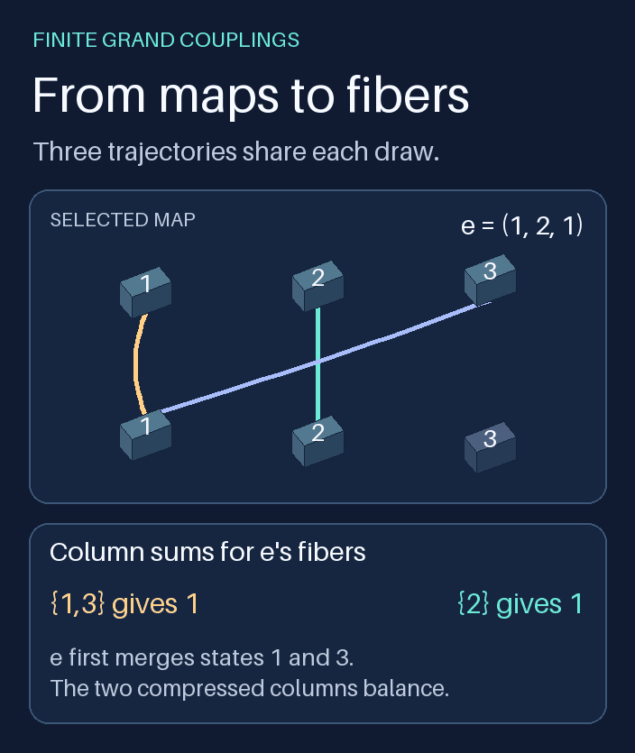

# Almost every finite Markov kernel coalesces under every grand coupling

  

For almost every finite Markov kernel in the source model, every consistent grand coupling coalesces under successive independent draws of its random map. A coupling with eventual rank k ≥ 2 forces k−1 independent affine equations on the kernel. The finite family of equations covers every exception.

[Read the paper](paper/manuscript.pdf) · [LaTeX source](paper/manuscript.tex) · [Proof outline](proof/PROBLEM_AND_PROOF.md) · [Run the replay](REPRODUCIBILITY.md)

## The first coalescing pair can vary

The maps e and f can merge different pairs on the first draw while retaining two trajectories forever. They both permute the two representatives after compression by e, giving column sums 1 and 1. Adding the constant map with probability 1/4 changes those sums to 5/4 and 3/4. All seven idempotent tests certify that every coupling of the perturbed kernel coalesces.

[Download the offline explorer](https://raw.githubusercontent.com/DannyExperiments/generic-grand-coupling-coalescence/refs/tags/v1.0.0/visualization/grand-coupling-explorer.zip), extract it, and open `index.html`. Select a map, change the mixing probability and rotate the diagram. [Figure guide](visualization/README.md)

## Prior results and scope

Grimmett and Holmes posed the almost-everywhere question after proving a positive-probability sufficient condition. Earlier block-coupling results require deterministic classes. The representative-row compression works for general finite supports and gives a uniform exponential tail for each certified kernel.

[Original question](https://api.repository.cam.ac.uk/server/api/core/bitstreams/db99cb9c-74e2-48f8-9312-4ca565a7a774/content#page=8) · [Pinned Q1017](https://github.com/10m-u/open-problems-catalog/blob/ca8d4d44ba3db527f19f28928c240168f545ecfe/problems/computer_science_ai/theory-of-computation-algorithms-part-1.md#q1017)

[Mathematical audit](audits/public_safe_reports/MATHEMATICAL_AUDIT.md) · [Literature audit](audits/public_safe_reports/LITERATURE_AUDIT.md) · [Scope](CLAIM_SCOPE_AND_LIMITATIONS.md) · [AI disclosure](AI_DISCLOSURE.md) · [Status](STATUS.md)

[Release v1.0.0](https://github.com/DannyExperiments/generic-grand-coupling-coalescence/releases/tag/v1.0.0) · [Version DOI](https://doi.org/10.5281/zenodo.24572905) · [Citation](CITATION.cff)
